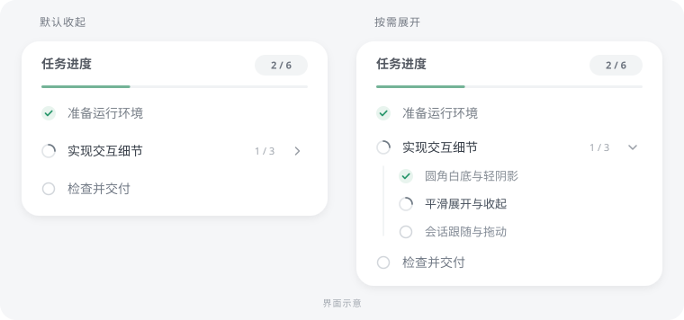

<p align="center">
  
</p>
<h1 align="center">Codex Plan Progress</h1>
<p align="center">把当前 Codex 聊天的执行计划放进一个小窗，完成一项，勾选一项。</p>
<p align="center"><strong>v1.3.0 · Windows · 本地聊天</strong></p>

> **安装前请确认：**自动跟随聊天需要运行中的 Codex 已启用本机回环调试接口（CDP，默认端口 `9229`）。**安装器不会开启调试接口，也不会修改 Codex 启动参数。**缺少接口或无法识别当前聊天时，小窗会隐藏；普通默认安装环境不保证直接可用。

<p align="center">
  
  <br><sub>界面示意。实际尺寸、字体与位置会随系统显示设置变化。</sub>
</p>

这是一个本地 Windows 伴随窗口，**不是嵌入 Codex 的原生卡片**，不修改 Codex 安装文件。目前仅支持 Windows 桌面上的本地 Codex 聊天，不支持网页端或远程聊天；本仓库不代表插件已在官方平台上架。

## 能做什么

| 功能 | 行为 |
| --- | --- |
| 真实任务状态 | 接收明确的待办、执行中、完成和受阻状态；不会按经过时间、工具次数或回复结束猜测完成。 |
| 全树计数 | 父任务和所有子任务均计入进度，折叠子项也不遗漏；子项完成不会自动完成父项。 |
| 多级计划 | 最多 100 项、6 层。子列表默认收起，在小窗打开期间按聊天记住分支展开、整体折叠与阅读位置。 |
| 跟随当前聊天 | 切换聊天后显示对应计划，后台任务更新不会抢走当前显示。 |
| 原生 WPF 绘制 | 默认在固定透明宿主内部呈现开合和状态动画，保留 Tk 兼容入口。 |
| 紧凑外观 | 白底圆角、轻阴影、完成数量和进度条；长列表在内部滚动。 |
| 自由拖动 | 拖动标题栏、计划标题或卡片空白处，在当前 Codex 窗口范围内放置并保存位置。 |
| 按场景隐藏 | 没有计划、离开主聊天页、进入设置或弹出对话框时隐藏；隐藏、折叠或暂停时停用循环状态动画。 |

## 快速开始

### 1. 准备环境

- Windows，以及已安装的 Codex 桌面应用和支持 `plugin` 命令的 **Codex CLI**。
- **Python 3.10+，包含 Tcl/Tk（`tkinter`）**。WPF 入口仍会导入共享的 Tk 模块，因此目前也需要 Tk。
- **Node.js 22+**，提供全局 `fetch` 和 `WebSocket`。
- **.NET Framework 4.8+** 为支持目标；系统需具备 WPF 程序集及 C# 编译器。安装器检查这些组件，不会下载 .NET。
- 已启用的 Codex 本机回环 CDP 接口，默认 `9229`；使用其他端口时可设置 `CODEX_PLAN_PROGRESS_CDP_PORT`。

`codex`、`node` 和 `python` 应能在 PowerShell 中直接运行，也就是位于 PATH。Python 不在 PATH 时，可以在安装时指定解释器。

### 2. 克隆并安装

在 PowerShell 中执行：

```powershell
git clone https://github.com/zhenghao21/codex-plan-progress.git
cd codex-plan-progress
powershell -NoProfile -ExecutionPolicy Bypass -File .\Install.ps1
```

指定 Python 的示例（请换成自己的实际路径）：

```powershell
powershell -NoProfile -ExecutionPolicy Bypass -File .\Install.ps1 -PythonPath "C:\Python312\python.exe"
```

安装器会检测依赖、生成本机配置，然后通过 Codex CLI 注册本地插件市场并安装插件。`-PrepareOnly` 仅生成本地配置，不注册或安装。首次打开 WPF 窗口时，会用系统编译器编译随附源码并缓存结果。

保留克隆目录；移动目录后，在新位置重新运行安装器。若当前聊天没有加载新工具，重新打开 Codex。

### 3. 可选：信任自动钩子

需要自动同步原生 `update_plan` 或监听执行结束、中断时，在 PowerShell 输入 `codex`。进入 **Codex CLI 的终端聊天**后输入 `/hooks`，审阅并信任本插件的钩子。

`/hooks` 不是普通 PowerShell 命令，也不是在桌面聊天里发送的一条消息。安装不会自动授予钩子信任；尚未信任时，仍可通过技能和 MCP 工具维护计划。

## 使用

在 Codex 聊天中输入：

> 使用 plan-progress，把这次执行计划显示在进度窗口。

也可以直接说“显示当前聊天的任务进度”。只有确实形成执行计划才建立列表，普通问答不会凭空生成计划。

| 工具 | 用途 |
| --- | --- |
| `set_plan` | 发布或完整替换当前聊天的计划；支持 `children` 多级子任务。 |
| `show_progress` | 启动窗口并显示当前聊天已有的计划，不绕过聊天识别条件。 |
| `get_progress` | 读取调用聊天的计划和完成数量。 |

每项包含 `step` 和 `status`，状态为 `pending`、`in_progress`、`completed`、`blocked`。更新时发送完整计划树，完成一项后立即更新对应状态。平面计划可通过已信任的钩子同步原生 `update_plan`；多级计划使用 `set_plan`，避免被平面计划覆盖。

技能会使用当前调用环境的会话身份；不要手工猜测聊天 ID。MCP 不可用时，技能提供本地 `launcher.ps1` 作为备用入口。

## 两个版本有什么区别

| | 完整版：`plugin/` | 技能源码草稿：`public-release/plugin/` |
| --- | --- | --- |
| 入口 | 根目录 `Install.ps1` 安装 | 供独立打包与提交准备；根安装器不安装它 |
| 组成 | 技能、MCP 服务、生命周期钩子、本地窗口 | 技能、本地 CLI、本地窗口；无 MCP 或钩子 |
| 计划更新 | MCP；可信钩子可同步原生平面计划 | 技能主动执行 CLI；原生 `update_plan` 不会自动镜像 |
| 执行状态 | 钩子可同步结束和中断 | 必须显式调用 `set-state`；不能自动检测硬中断 |
| 默认数据目录 | `%LOCALAPPDATA%\CodexPlanProgress` | `%LOCALAPPDATA%\CodexPlanProgressPublic` |

两者都需要本地依赖和当前聊天识别接口。技能源码草稿不是免依赖便携包，也不代表官方已发布；详情见 [公开草稿说明](public-release/README.md)。

## 本地数据与配置

- 计划按聊天保存在数据目录的 `threads/`；`placement.json` 保存位置和宽度。设置 `CODEX_PLAN_PROGRESS_DATA` 可指定数据目录。
- `plugin/runtime.json` 和 `plugin/.mcp.json` 由安装器生成，包含当前机器的解释器和目录信息；这些本机配置不纳入 Git。
- WPF 编译结果缓存在数据目录的 `runtime/wpf-<版本>/`，不是需要提交的源码。分发源码时需保留 `.cs` 文件和应用清单。
- 观察器只读取识别当前聊天所需的界面属性、标题元数据和本地 ID 映射，不读取消息正文、不修改页面。MCP 或 CLI 可向调用聊天返回其计划数据。

## 常见问题

**安装成功但没有窗口？** 先确认当前聊天确有已保存的结构化计划，Codex 位于前台主聊天页，且回环 CDP 接口已启用。缺少接口、没有计划或无法确认当前聊天时，隐藏是预期行为；调用“显示进度”不会强行显示其他聊天。

**能自动判断任务做完了吗？** 不能。勾选来自 Codex 明确更新的任务状态；失败、暂停或回答结束都不会把未完成任务勾上。

**升级后位置会变吗？** 位置保存在数据目录，重新安装不会主动重置。卡片不会自动检测 Codex 原生卡片的高度，可通过拖动调整。

**能切回 Tk 吗？** 可以，用原数据目录启动兼容入口：`python .\plugin\scripts\overlay.py --renderer tk --data-dir "$env:LOCALAPPDATA\CodexPlanProgress"`。两种显示层共用单实例锁，先关闭已运行的小窗。

**支持所有 Codex 版本或固定帧率吗？** 不保证。当前聊天识别依赖 Codex 内部界面结构，更新后可能需要适配；动画效果也取决于机器、DPI 和桌面负载。

## 卸载

```powershell
powershell -NoProfile -ExecutionPolicy Bypass -File .\Uninstall.ps1
```

卸载会移除插件及本地市场登记，保留计划、位置和项目文件。重新打开 Codex；若小窗仍在，手动关闭即可。

## 源码与测试

```text
.agents/plugins/       本地插件市场清单
plugin/                完整版插件清单、技能、钩子与程序
plugin/scripts/        状态服务、聊天观察器、WPF 与 Tk 显示层
public-release/        skills-only 源码草稿与可选便携构建脚本
tests/                 Python、C# 与 Node.js 回归测试
docs/assets/           仓库首页界面示意
```

在仓库根目录运行：

```powershell
python -m unittest discover -s tests -p "test_*.py"
node --test tests/test_active_thread.mjs
```

测试需要上述本地依赖；Tk 测试可能短暂创建测试窗口。当前开发机已通过 **51 项 Python 测试和 13 项 Node.js 测试**，其中包含直接编译实际 WPF 源码的 C# 行为检查，覆盖会话隔离、观察失效、完整计划更新、嵌套布局、动画连续性、拖动和视图状态。

这些结果不等同于干净机器的完整安装验证或显示帧率测量。目前尚未完成干净 Windows 安装和可选便携包的验证。
